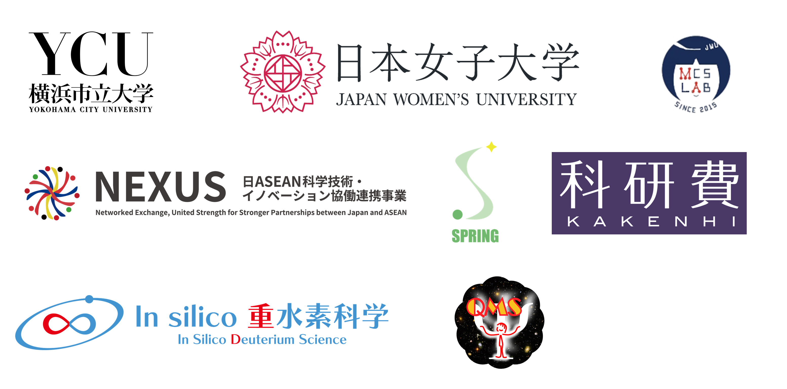

<b>The 12th Japan-Thai workshop on Theoretical and Computational Chemistry (JTTCC12)</b> will be held on <b>Saturday, 12th December 2026</b> in an in-person form, at <b>Yokohama City University</b> (Kanazawa-Hakkei Campus), Yokohama, Japan. This workshop aims to promote international exchange of researchers and students in quantum chemistry between Japan and the Kingdom of Thailand. There will be oral and poster sessions. Oral presentations will be given by invited speakers, and contributed poster presentations will be given by young researchers, especially by graduate students. We look forward to seeing you there. 
 

# Registration

| Date |  |
| :--- | :--- |
| ??th November 2026 | Deadline for Registration as a contributed poster presenter |
| 11th December 2026 | Deadline for Online registration as a participant |

# Program

 <b>Saturday, 12th December 2026</b> 

The timetable is to be determined. We will keep you posted.

<!--
| Start | End   | Speaker | Title |
| :---: | :---: | :------ | :---- |
| 13:30 | 13:50 | | **Registration** |
| 13:50 | 14:00 | | **Opening remarks** by Prof. John Doe |
| 14:00 | 14:30 | John Doe | New universality of the nuclear quantum effects in proton science |
| 14:30 | 15:00 | John Doe | New universality of the nuclear quantum effects in proton science |
| 15:00 | 15:20 | | **Coffee Break** |
| 15:20 | 15:40 | John Doe | New universality of the nuclear quantum effects in proton science |
| 15:40 | 16:00 | John Doe | New universality of the nuclear quantum effects in proton science |
| 16:00 | 16:30 | | **Poster Session** (by speakers who have odd no.) |
| 16:30 | 17:00 | | **Poster Session** (by speakers who have even no.) |
| 17:00 | 17:20 | John Doe | New universality of the nuclear quantum effects in proton science |
| 17:20 | 17:40 | John Doe | New universality of the nuclear quantum effects in proton science |
| 17:40 | 17:50 | | **Closing remarks** by Prof. John Doe |
| 17:50 | 18:00 | | **Award ceremony** by Prof. John Doe |
| 18:30 | 21:00 | | **Banquet** at _Ristorante Prima Stella_ |

# Invited Speakers

Meet the invited speakers:

- [__Prof. Siriporn Jungsuttiwong__](https://staff.sci.ubu.ac.th/siriporn.j) from Ubon Ratchathani University, Thailand.
   Her research interests focus on Computational Chemistry, Catalytic reactivity of nanomaterialsis.

- [__Assoc. Prof. Nawee Kungwan__](https://scholar.google.com/citations?user=uEL0PjoAAAAJ&hl=en) from Chiang Mai University, Thailand.
   Computational Chemistry (dye-sensitized solar cells, light emitting materials, catalyst in ring-opening polymerization, catalytic materials for hazardous gas adsorption, excited-state proton transfer and molecular design for fluorescent probes)

# Poster Session

The presenters with odd numbers will have poster presentations first half, and those with even numbers second half. Each poster board is 90cm x 120cm (width x height).

| No. | Name | Title |
| :-- | :--- | :---- |
|  1 | John Doe | New universality of the nuclear quantum effects in proton science |
|  2 | John Doe | New universality of the nuclear quantum effects in proton science |
|  3 | John Doe | New universality of the nuclear quantum effects in proton science |
|  4 | John Doe | New universality of the nuclear quantum effects in proton science |
|  5 | John Doe | New universality of the nuclear quantum effects in proton science |
|  6 | John Doe | New universality of the nuclear quantum effects in proton science |
|  7 | John Doe | New universality of the nuclear quantum effects in proton science |
|  8 | John Doe | New universality of the nuclear quantum effects in proton science |
|  9 | John Doe | New universality of the nuclear quantum effects in proton science |
| 10 | John Doe | New universality of the nuclear quantum effects in proton science |

-->

# Venue

### Oral Session
Room 141 (Main conference room), Arts Research Building 1F 
Kanazawa-Hakkei Campus, Yokohama City University 
Yokohama, Japan 
 
横浜市立大学 (金沢八景キャンパス) 
文科系研究棟1階　大会議室

### Poster Session &amp; Conference Mixer
Entrance hall (1F), Science Research Building 
Kanazawa-Hakkei Campus, Yokohama City University 
Yokohama, Japan 
 
横浜市立大学 (金沢八景キャンパス) 
理学系研究棟1階　エントランスホール 
 

# Access

[Kanazawa-Hakkei Campus of Yokohama City University](https://goo.gl/maps/UwE5dQeStBsi8jVu5) is a 5-minutes walk from [Kanazawa-Hakkei Station](https://maps.app.goo.gl/mWU5TP94mPia5UZX8) of [Keikyu line](https://www.haneda-tokyo-access.com/en/).

<iframe src="https://www.google.com/maps/embed?pb=!1m14!1m8!1m3!1d13019.591406458434!2d139.5989118!3d35.333358!3m2!1i1024!2i768!4f13.1!3m3!1m2!1s0x601843fd143d2285%3A0xa2bfcf87b9aac00d!2sYokohama%20City%20University%20Kanazawa-Hakkei%20Campus!5e0!3m2!1sen!2sjp!4v1704183177009!5m2!1sen!2sjp" width="600" height="450" style="border:0;margin-bottom:30px; max-width: 100%;" allowfullscreen="" loading="lazy" referrerpolicy="no-referrer-when-downgrade"></iframe>

 

<iframe src="./hakkei-campus-map_en_2D_a1758072992948.pdf" width="600" height="450" style="border:0;margin-bottom:30px; max-width: 100%;"></iframe>
Oral sessions: Arts Research Building (14) 
Poster Session &amp; Conference Mixer : Science Research Building (13) 
 

## Local Organizing Committee

Dean and Prof. Masanori TACHIKAWA (Graduate School of Nanobioscience, Yokohama City University) and [Quantum Physical Chemistry Laboratory, Yokohama City University](https://www-user.yokohama-cu.ac.jp/~tachi/en/).

 

## Acknowledgment

This workshop is organized by the [Graduate School of NanoBioScience (Yokohama City University)](https://www.yokohama-cu.ac.jp/english/academics/graduate/nanobio/index.html), [Graduate School of Medical Life Science (Yokohama City University)](https://www.yokohama-cu.ac.jp/english/academics/graduate/mls/index.html), [Muraoka Group (Japan Women's University)](https://mcm-www.jwu.ac.jp/~muraoka/index.php), and [NEXUS (JST)](https://www.jst.go.jp/aspire/nexus/y-tec/en/theme/2025/vol016.html), sponsored by [SPRING program (Yokohama City University)](https://www.yokohama-cu.ac.jp/spring/English/About_SPRING.html) and [Grant-in-Aid for Scientific Research(S) (MEXT, KAKENHI)](https://ycuqpc.github.io/kibanS-25H00428/), and supported by the [International Affairs Office (Yokohama City University)](https://www.yokohama-cu.ac.jp/english/global/international/index.html) and [Grant-in-Aid for Transformative Research Areas (A) (MEXT, KAKENHI)](https://lambda.phys.tohoku.ac.jp/qm-science/en/). 
 

