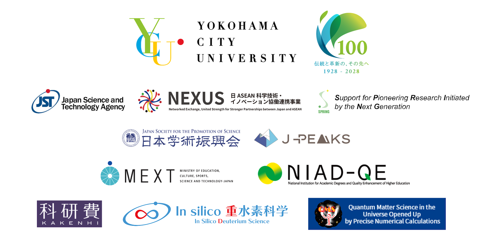

<b>The 12th Japan-Thai workshop on Theoretical and Computational Chemistry (JTTCC12)</b> will be held on <b>11&ndash;12 December 2026</b> in an in-person form, at <b>Yokohama City University</b> (Kanazawa-Hakkei Campus), Yokohama, Japan. This workshop aims to promote international exchange of researchers and students in quantum chemistry between Japan and the Kingdom of Thailand. There will be oral and poster sessions. Oral presentations will be given by invited speakers, and contributed poster presentations will be given by young researchers, especially by graduate students. We look forward to seeing you there. 
  

# Registration

Please fill out this <b>[registration form](https://forms.cloud.microsoft/r/iKvwz0DNBx)</b>.
<b>We are now calling for contributed poster presenters.</b>
 

<b>Registration deadline</b> 
• for a contributed poster presenter: 30 November 2026 
• for all participants: 11 December 2026 
 
<b>Registration fees:</b> 
<i>The registration fee includes lunch, refreshments during coffee breaks, and snacks and beverages at the mixer. Please pay in cash at the registration desk on 12 Dec.</i> 
• General: 4,000 JPY 
• Postdoc (young researcher): 2,000 JPY 
• Student: 1,000 JPY 
• Invited speaker <i>from Japan</i>: 4,000 JPY 
• Guest (from Thailand): Free 
  

# Program

The timetable is still provisional, and is subject to change. 

### Day 1 (Friday, 11 December 2026) 

#### Opening Remarks

| Start | End   |         |
| :---: | :---: | :------ |
| 12:50 | 13:00 | **Welcome to JTTCC12 workshop** by **Masanori Tachikawa** (Dean and Professor of Graduate School of NanoBioScience, Yokohama City University, Japan) |

<!--

  

-->
 

#### Oral Session 1-1

Chair: **TBA**

| Start | End   |         |
| :---: | :---: | :------ |
| 13:00 | 13:25 | **Daisuke Yoshida** (Tohoku University, Japan) Positron Binding and Annihilation in Molecules: Insights From First-Principles Calculations |
| 13:25 | 13:50 | **Kaito Takahashi** (Thammasat University, Thailand) Theoretical View of C-C Coupling on Graphyne: Orbitals, Electric Field and Surface State |
| 13:50 | 14:15 | **Kowit Hengphasatporn** (University of Tsukuba, Japan) Multiscale Computing of Supramolecular Motion |
| 14:15 | 14:25 | **Coffee Break (10 min.)** |

<!--

  
  
  

-->
 

#### Oral Session 1-2

Chair: **TBA**

| Start | End   |         |
| :---: | :---: | :------ |
| 14:25 | 14:50 | **Tokuhisa Kawawaki** (Yokohama City University, Japan) Metal Clusters and Single-Atom Catalysts for Precise Control of Reaction Pathways |
| 14:50 | 15:15 | **Thanthapatra Bunchuay** (Mahidol University, Thailand) Molecular Recognition and Functional Translation through a Champion Supramolecular Platform for Critical Metal Recovery |
| 15:15 | 15:40 | **Manussada Ratanasak** (University of Tsukuba, Japan) Mechanistic Insights into Secondary Metal Promotion in Fe3O-Based MOF Catalysts for Enhanced CO2 Hydrogenation to Formic Acid |
| 15:40 | 15:50 | **Coffee Break (10 min.)** |

<!--

  
  
  

-->
 

#### Oral Session 1-3

Chair: **TBA**

| Start | End   |         |
| :---: | :---: | :------ |
| 15:50 | 16:15 | **Seiji Mori** (Ibaraki University, Japan) Computational Research Developed Through Academic Partnerships with Thailand and Other Countries |
| 16:15 | 16:40 | **Kei Terayama** (Yokohama City University, Japan) Exploring Cross-Domain Ideas for Materials Research with Large Language Models |
| 16:40 | 17:05 | **David S. Rivera Rocabado** (Osaka Metropolitan University, Japan) Understanding and Predicting Catalytic Properties with the Electronic Structure Decomposition Approach |
| 17:05 | 17:15 | **Coffee Break (10 min.)** |

<!--

  
  
  

-->
 

#### Oral Session 1-4

Chair: **TBA**

| Start | End   |         |
| :---: | :---: | :------ |
| 17:15 | 17:25 | **Thanapat Charoenkitkaset** (Chiang Mai University, Thailand) Nuclear quantum effects on hydrogen bonds in protonated clusters of water, hydrogen sulfide, and hydrogen sulfide–water |
| 17:25 | 17:35 | **Phitchayatida Promdee** (Ubon Ratchathani University, Thailand) Unveiling the Role of Metal Dopants in NiOOH for Ethylene Glycol Electro oxidation toward Formate Production |
| 17:35 | 17:45 | **Jiraprapa Kanlana** (Ubon Ratchathani University, Thailand) First-Principles Study of Na Adsorption and Diffusion in MXene/MOF Heterostructures for Sodium-Ion Batteries |
| 17:45 | 17:55 | **Chadapa Koonperm** (Ubon Ratchathani University, Thailand) Design and Investigation of Integrative Catalytic Pairs on Biphenylene for Electrochemical Urea Synthesis from Carbon Dioxide and Nitrate; Density Functional Theory Study |
| 17:55 | 18:05 | **Sutthiphan Vajirakaphan** (Chulalongkorn University, Thailand) AEM Hybrid Electrolyser |
| 18:05 | 18:15 | **Chirasuta Chitchong** (Chulalongkorn University, Thailand) Waste-to-value electrooxidation coupled with hydrogen production |
| 18:15 | 18:25 | **Thanathrid Wongchotsathit** (Chulalongkorn University, Thailand) On-Demand Hydrogen Production via LED-Powered Electrolyte-Free Photocatalytic Water Splitting |

<!--

  
  
  
 
  
  
  
 
  

-->
 

#### Conference Mixer (Day 1)

| Start | End   |         |
| :---: | :---: | :------ |
| 18:25 | 18:30 | **Group photo (Day 1)** |
| 18:30 | 21:00 | **Conference Mixer** |

<!--

  
  
  
 
  
  
  

-->
 

### Day 2 (Saturday, 12 December 2026) 

#### Opening Remarks

| Start | End   |         |
| :---: | :---: | :------ |
| 9:30 | 9:40 | **Opening Remarks** by **Masaru Tachibana** (Vice president, Professor of Graduate School of NanoBioScience, Yokohama City University, Japan) |
| 9:40 | 9:50 | **Welcome speech** by **Mitsunori Ikeguchi** (Vice president, Professor of Graduate School of Medical Life Science, Yokohama City University, Japan) |

<!--

  
  

-->
 

#### Oral Session 2-1

Chair: **TBA**

| Start | End   |         |
| :---: | :---: | :------ |
|  9:50 | 10:15 | **Yusuke Kanematsu** (Hiroshima University, Japan) <i>TBA</i> |
| 10:15 | 10:40 | **Tatsuhiro Murakami** (Tokyo Metropolitan University, Japan) Development of Machine Learning Interatomic Potentials for Deep Eutectic Solvents |
| 10:40 | 11:00 | **Coffee Break (20 min.)** |

<!--

  
  

-->
 

#### Oral Session 2-2

Chair: **TBA**

| Start | End   |         |
| :---: | :---: | :------ |
| 11:00 | 11:25 | **Taro Udagawa** (Gifu University, Japan) <i>TBA</i> |
| 11:25 | 11:50 | **Kazuaki Kuwahata** (Institute of Science Tokyo, Japan) Theoretical Study of Muoniated Molecules Using PIMD: Importance of Multidimensional Quantum Effects |
| 11:50 | 12:15 | **Soungmin Bae** (Gifu University, Japan) Nuclear Quantum Effects on Collective Lattice Dynamics and Negative Thermal Expansion |
| 12:15 | 13:15 | **Lunch Break (60 min.)** |

<!--

  
  
  

-->
 

#### Oral Session 2-3

Chair: **TBA**

| Start | End   |         |
| :---: | :---: | :------ |
| 13:15 | 13:40 | **Tetsuya Taketsugu** (Hokkaido University, Japan) <i>TBA</i> |
| 13:40 | 14:05 | **Nawee Kungwan** (Chiang Mai University, Thailand) Nuclear quantum effects on hydrogen bonds in protonated clusters of water, hydrogen sulfide, and hydrogen sulfide–water |
| 14:05 | 14:30 | **Kohki Oka** (Tohoku University, Japan) Organic Energy Materials towards Zero Carbon |
| 14:30 | 14:55 | **Chanon Pornrungroj** (Chulalongkorn University, Thailand) <i>TBA</i> |
| 14:55 | 15:15 | **Coffee Break (20 min.)** |

<!--

  
  
 
  
  

-->
 

#### Oral Session 2-4

Chair: **TBA**

| Start | End   |         |
| :---: | :---: | :------ |
| 15:15 | 15:40 | **Siriporn Jungsuttiwong** (Ubon Rathchathani University, Thailand) Bridging Experiment and Theory for Next-Generation Energy Conversion and Storage Materials: Toward Climate Solutions |
| 15:40 | 16:05 | **Yuthana Tantirungrotechai** (Thammasat University, Thailand) <i>TBA</i> |
| 16:05 | 16:30 | **Panichakorn Jaiyong** (Thammasat University, Thailand) <i>TBA</i> |
| 16:30 | 16:55 | **Azusa Muraoka** (Japan Women’s University, Japan) <i>TBA</i> |

<!--

  
  
 
  
  

-->
 

#### Closing Remarks

| Start | End   |         |
| :---: | :---: | :------ |
| 16:55 | 17:05 | **Closing remarks** by **Masanori Tachikawa** (Dean and Professor of Graduate School of NanoBioScience, Yokohama City University, Japan) |
| 17:05 | 17:10 | **Group photo (Day 2)** |

<!--

  

-->
 

#### Poster Session &amp; Conference Mixer (Day 2)

| Start | End   |         |
| :---: | :---: | :------ |
| 17:30 | 18:00 | **Poster session 1 (posters with odd numbers)** |
| 18:00 | 18:30 | **Poster session 2 (posters with even numbers)** |
| 18:30 | 21:00 | **Conference Mixer** |

<!--

  
  
  
 
  
  
  

-->
 
 

#### List of Posters

| Poster No. |  |
| :---: | :---- |
| P1 | **Ken Inoue** (Yokohama City University, Japan) <i>TBA</i> |
| P2 | **Saho Kobayashi** (Japan Women’s University, Japan) Interpretable Machine Learning for Band Gap Prediction and Structural Analysis of 2D Perovskites |
| P3 | **Saki Tanaka** (Japan Women’s University, Japan) <i>TBA</i> |
| P4 | **Kanami Saito** (Japan Women's University, Japan) <i>TBA</i> |
| P5 | **Masanari Natsume** (Yokohama City University, Japan) <i>TBA</i> |
| P6 | **Thitipattra Buabanprom** (Thammasat University, Thailand) MMolecular Dynamics Simulation of Polysorbate 20-based Niosomes as Drug Delivery Systems |
| P7 | **Cao Tri Vu** (Thammasat University, Thailand) Molecular Dynamics-Guided Rational Engineering of Cyan Fluorescent Proteins |
| P8 | **Watcharin Kumaeum** (Thammasat University, Thailand) <i>TBA</i> |
| P9 | **Chinnipha Wannaphan** (Thammasat University, Thailand) Virtual Screening of Bioactive Compounds from Thai Mushrooms as Potential ATG4B Inhibitors |
| P10 | **Nanami Suzuki** (Japan Women's University, Japan) <i>TBA</i> |
| P11 | **Yachen Zhao** (Yokohama City University, Japan) Comprehensive band-gap study of InxGa1−xN based on density functional theory |

  

<!--
| Start | End   | Speaker | Title |
| :---: | :---: | :------ | :---- |
| 13:30 | 13:50 | | **Registration** |
| 13:50 | 14:00 | | **Opening remarks** by Prof. John Doe |
| 14:00 | 14:30 | John Doe | New universality of the nuclear quantum effects in proton science |
| 14:30 | 15:00 | John Doe | New universality of the nuclear quantum effects in proton science |
| 15:00 | 15:20 | | **Coffee Break** |
| 15:20 | 15:40 | John Doe | New universality of the nuclear quantum effects in proton science |
| 15:40 | 16:00 | John Doe | New universality of the nuclear quantum effects in proton science |
| 16:00 | 16:30 | | **Poster Session** (by speakers who have odd no.) |
| 16:30 | 17:00 | | **Poster Session** (by speakers who have even no.) |
| 17:00 | 17:20 | John Doe | New universality of the nuclear quantum effects in proton science |
| 17:20 | 17:40 | John Doe | New universality of the nuclear quantum effects in proton science |
| 17:40 | 17:50 | | **Closing remarks** by Prof. John Doe |
| 17:50 | 18:00 | | **Award ceremony** by Prof. John Doe |
| 18:30 | 21:00 | | **Banquet** at _Ristorante Prima Stella_ |

# Invited Speakers

Meet the invited speakers:

- [__Prof. Siriporn Jungsuttiwong__](https://staff.sci.ubu.ac.th/siriporn.j) from Ubon Ratchathani University, Thailand.
   Her research interests focus on Computational Chemistry, Catalytic reactivity of nanomaterialsis.

- [__Assoc. Prof. Nawee Kungwan__](https://scholar.google.com/citations?user=uEL0PjoAAAAJ&hl=en) from Chiang Mai University, Thailand.
   Computational Chemistry (dye-sensitized solar cells, light emitting materials, catalyst in ring-opening polymerization, catalytic materials for hazardous gas adsorption, excited-state proton transfer and molecular design for fluorescent probes)

# Poster Session

The presenters with odd numbers will have poster presentations first half, and those with even numbers second half. Each poster board is 90cm x 120cm (width x height).

| No. | Name | Title |
| :-- | :--- | :---- |
|  1 | John Doe | New universality of the nuclear quantum effects in proton science |
|  2 | John Doe | New universality of the nuclear quantum effects in proton science |
|  3 | John Doe | New universality of the nuclear quantum effects in proton science |
|  4 | John Doe | New universality of the nuclear quantum effects in proton science |
|  5 | John Doe | New universality of the nuclear quantum effects in proton science |
|  6 | John Doe | New universality of the nuclear quantum effects in proton science |
|  7 | John Doe | New universality of the nuclear quantum effects in proton science |
|  8 | John Doe | New universality of the nuclear quantum effects in proton science |
|  9 | John Doe | New universality of the nuclear quantum effects in proton science |
| 10 | John Doe | New universality of the nuclear quantum effects in proton science |

-->

# Venue

### Oral Session
Room 141 (Main conference room), Arts Research Building 1F 
Kanazawa-Hakkei Campus, Yokohama City University 
Yokohama, Japan 
 
横浜市立大学 (金沢八景キャンパス) 
文科系研究棟1階　大会議室

### Poster Session &amp; Conference Mixer
Entrance hall (1F), Science Research Building 
Kanazawa-Hakkei Campus, Yokohama City University 
Yokohama, Japan 
 
横浜市立大学 (金沢八景キャンパス) 
理学系研究棟1階　エントランスホール 
 

# Access

[Kanazawa-Hakkei Campus of Yokohama City University](https://goo.gl/maps/UwE5dQeStBsi8jVu5) is a 5-minutes walk from [Kanazawa-Hakkei Station](https://maps.app.goo.gl/mWU5TP94mPia5UZX8) of [Keikyu line](https://www.haneda-tokyo-access.com/en/).

<iframe src="https://www.google.com/maps/embed?pb=!1m14!1m8!1m3!1d13019.591406458434!2d139.5989118!3d35.333358!3m2!1i1024!2i768!4f13.1!3m3!1m2!1s0x601843fd143d2285%3A0xa2bfcf87b9aac00d!2sYokohama%20City%20University%20Kanazawa-Hakkei%20Campus!5e0!3m2!1sen!2sjp!4v1704183177009!5m2!1sen!2sjp" width="600" height="450" style="border:0;margin-bottom:30px; max-width: 100%;" allowfullscreen="" loading="lazy" referrerpolicy="no-referrer-when-downgrade"></iframe>

 

<iframe src="./hakkei-campus-map_en_2D_a1758072992948.pdf" width="600" height="450" style="border:0;margin-bottom:30px; max-width: 100%;"></iframe>
Oral sessions: Arts Research Building (14) 
Poster Session &amp; Conference Mixer : Science Research Building (13) 
 

## Local Organizing Committee

Dean and Prof. Masanori TACHIKAWA (Graduate School of Nanobioscience, Yokohama City University) and [Quantum Physical Chemistry Laboratory, Yokohama City University](https://www-user.yokohama-cu.ac.jp/~tachi/en/).

 

## Acknowledgment

This workshop is organized by the [Graduate School of NanoBioScience (Yokohama City University)](https://www.yokohama-cu.ac.jp/english/academics/graduate/nanobio/index.html), [Graduate School of Medical Life Science (Yokohama City University)](https://www.yokohama-cu.ac.jp/english/academics/graduate/mls/index.html), and [NEXUS (JST)](https://www.jst.go.jp/aspire/nexus/y-tec/en/theme/2025/vol016.html), sponsored by [J-PEAKS (JSPS)](https://www.yokohama-cu.ac.jp/j-peaks/index.html), [SPRING (JST)](https://www.yokohama-cu.ac.jp/spring/English/About_SPRING.html), [Support Program for Strengthening the Functions of Universities and Colleges of Technology (MEXT, NIAD-QE)](https://www.yokohama-cu.ac.jp/news/2026/20260918saitaku.html), and [Grant-in-Aid for Scientific Research(S) (MEXT, KAKENHI)](https://ycuqpc.github.io/kibanS-25H00428/), and supported by the [International Affairs Office (Yokohama City University)](https://www.yokohama-cu.ac.jp/english/global/international/index.html) and [Grant-in-Aid for Transformative Research Areas (A) (MEXT, KAKENHI)](https://lambda.phys.tohoku.ac.jp/qm-science/en/). 
 

